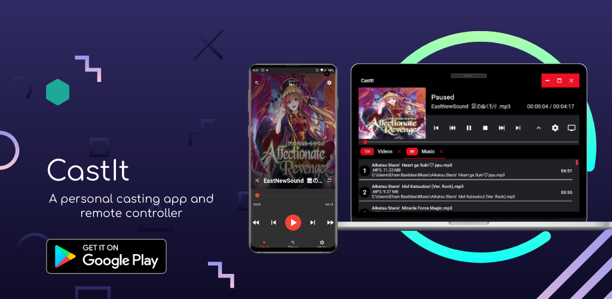
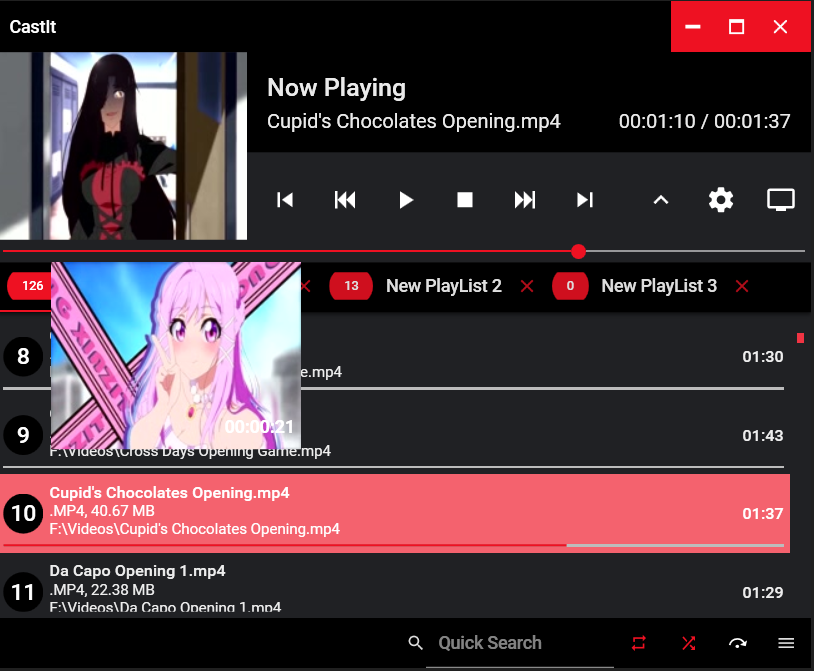
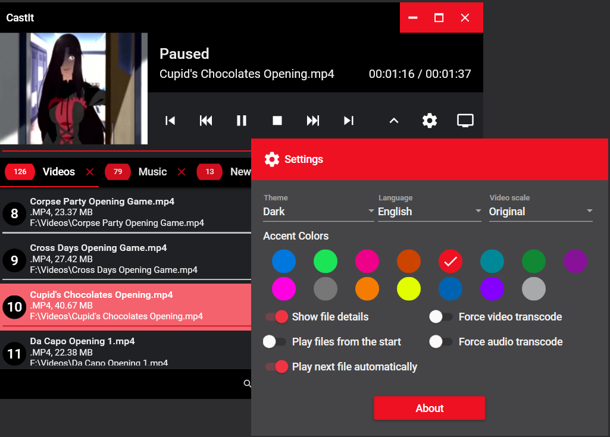
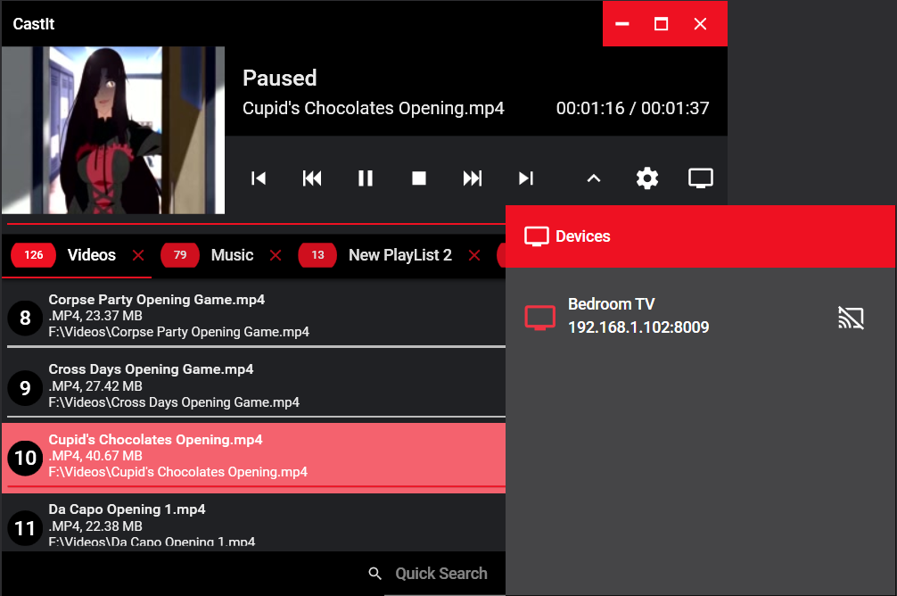
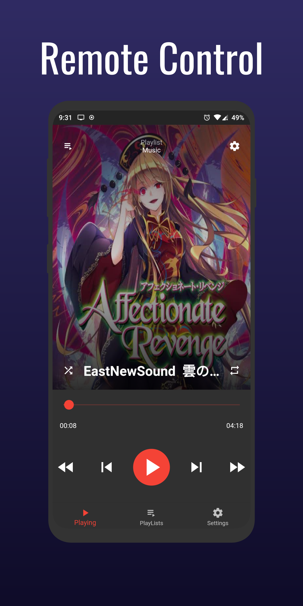
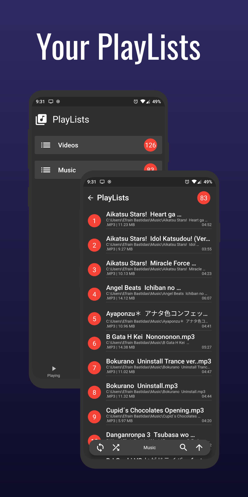
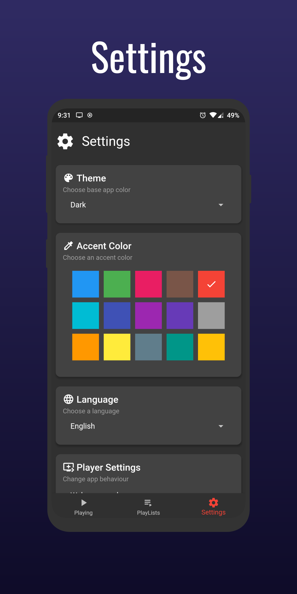

# CastIt
<p align="center">
  
</p>

> A casting app and remote controller made for my personal use.
<p align="center">
  
</p>

## Windows

<p align="center">
  
</p>

<p align="center">
      
</p>

<p align="center">
      
</p>

Get the latest release [here](https://github.com/Wolfteam/CastIt/releases).

## Android
<p align="center">
      
      
  
</p>

[](https://play.google.com/store/apps/details?id=com.miraisoft.castit)

## Features
* Playlists
* Themes
* Drag and drop files
* And all the good stuff that comes in casting apps

## Build

### Server

Build the image locally:

```
docker build --build-arg TARGETARCH=arm64 -t castit -f CastIt.Server/Dockerfile .
```

#### Manual export / import (tarball)

Save the built image to a gzipped tarball, copy it to the target host, and load it:

```
docker save castit | gzip > ~/Development/castit.tar.gz
docker load < castit.tar.gz
```

#### Push to a registry

[`push-image.sh`](push-image.sh) builds for `linux/arm64` and pushes the image tagged with the **last commit's short hash** and `:latest` (defaults: `--image castit`, `--dockerfile CastIt.Server/Dockerfile`):

```
./push-image.sh --registry <registry-host>
```

It logs in if needed, warns on a dirty working tree, and pushes both tags. Add `--sha-only` to skip `:latest`; run `./push-image.sh --help` for all options.
